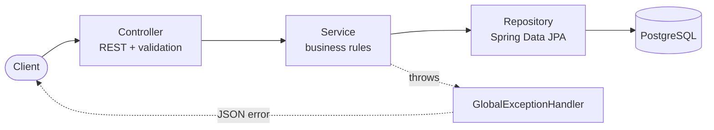
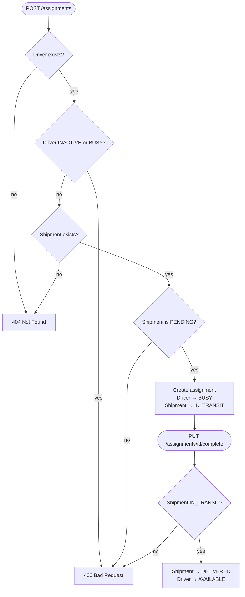
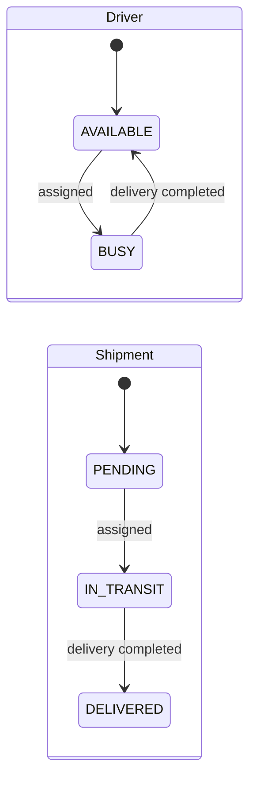

# Texas Logistics API

🇺🇸 English | [🇧🇷 Português](README.pt-BR.md)

A RESTful logistics API built with **Java 21** and **Spring Boot 4**. It manages **drivers**, **shipments**, and the **assignments** that connect them, enforcing real business rules such as driver availability and shipment lifecycle.

> Built as a hands-on learning project for Java backend development.

## Features

- Full CRUD for drivers and shipments
- Assignment workflow: assign a driver to a shipment, then complete the delivery
- Business rules enforced in the service layer (see [Business rules](#business-rules))
- Pagination, sorting, and optional status filtering on listings
- Bean Validation on all request bodies
- Centralized error handling with a consistent JSON error format
- Interactive API documentation with Swagger UI (OpenAPI)
- Unit tests with JUnit 5, Mockito, and AssertJ

## Tech stack

| Area | Technology |
|---|---|
| Language | Java 21 |
| Framework | Spring Boot 4.0.6 (Web MVC, Data JPA, Validation) |
| Database | PostgreSQL |
| Build | Maven (Maven Wrapper included) |
| API docs | springdoc OpenAPI / Swagger UI |
| Testing | JUnit 5, Mockito, AssertJ |

## Architecture

Every request follows the same layered flow. Entities never leave the API: requests and responses use DTOs.



Project structure (root package `com.jose.texaslogistics`):

```
driver/      Driver entity, controller, service, repository, DTOs, exceptions
shipment/    Shipment entity, controller, service, repository, DTOs, exceptions
assignment/  Assignment entity, controller, service, repository, DTOs, exceptions
exception/   GlobalExceptionHandler (one handler for all modules)
config/      OpenAPI configuration
```

## Business rules

The core of the project is the lifecycle of drivers and shipments, driven by assignments:



State summary:



Other rules:

- A driver that has assignments **cannot be deleted** (returns `409 Conflict`).
- `createAssignment` runs inside a transaction, so the driver and shipment status changes succeed or fail together.

## Endpoints

| Method | Path | Description |
|---|---|---|
| `POST` | `/drivers` | Create a driver |
| `GET` | `/drivers` | List drivers (paginated, optional `status` filter) |
| `GET` | `/drivers/{id}` | Get a driver by ID |
| `PUT` | `/drivers/{id}` | Update a driver |
| `DELETE` | `/drivers/{id}` | Delete a driver (blocked if it has assignments) |
| `POST` | `/shipments` | Create a shipment |
| `GET` | `/shipments` | List shipments (paginated, optional `status` filter) |
| `GET` | `/shipments/{id}` | Get a shipment by ID |
| `PUT` | `/shipments/{id}` | Update a shipment |
| `DELETE` | `/shipments/{id}` | Delete a shipment |
| `POST` | `/assignments` | Assign a driver to a shipment |
| `GET` | `/assignments` | List assignments (paginated) |
| `GET` | `/assignments/{id}` | Get an assignment by ID |
| `GET` | `/assignments/driver/{driverId}` | List assignments of a driver |
| `PUT` | `/assignments/{id}/complete` | Complete a delivery |

Pagination parameters on listings: `page`, `size`, `sort` (for example `/drivers?status=AVAILABLE&page=0&size=10&sort=name,asc`).

### Error responses

| Status | When |
|---|---|
| `400 Bad Request` | Validation failed, or a business rule was violated (inactive/busy driver, shipment not assignable, shipment not in transit) |
| `404 Not Found` | Driver, shipment, or assignment does not exist |
| `409 Conflict` | Deleting a driver that has assignments |

Example:

```json
{
  "timestamp": "2026-10-28T23:44:45.806397Z",
  "status": 409,
  "error": "Conflict",
  "message": "Driver with id 8 cannot be deleted because it has assignments."
}
```

## Getting started

### Prerequisites

- Java 21
- PostgreSQL running locally

### 1. Create the database

The default configuration expects PostgreSQL on port `5433` and a database named `texas_logistics_db`:

```sql
CREATE DATABASE texas_logistics_db;
```

### 2. Configure credentials

Edit `src/main/resources/application.properties` and set the datasource URL, username, and password for your machine. Do not commit real passwords to a public repository.

### 3. Run the application

```bash
./mvnw spring-boot:run
```

The API starts at `http://localhost:8080`.

### 4. Explore the API

Open Swagger UI: <http://localhost:8080/swagger-ui/index.html>

## Running the tests

```bash
./mvnw clean test
```

The suite currently has **15 unit tests** covering the driver and assignment services (success paths and every business-rule failure), using JUnit 5 and Mockito with the Arrange-Act-Assert pattern.

## Roadmap

- [ ] Swagger documentation for shipments and assignments
- [ ] Standardized `ErrorResponse` documented in OpenAPI
- [ ] `ShipmentService` tests, controller tests (MockMvc), and integration tests (Testcontainers)
- [ ] Docker and docker-compose with PostgreSQL
- [ ] Optimistic locking to prevent duplicate assignments under concurrency
- [ ] Spring Security with JWT and role-based access (admin, dispatcher, driver)
- [ ] Status history and auditing

## Author

**José Neto**: [GitHub](https://github.com/zeneto2978)
