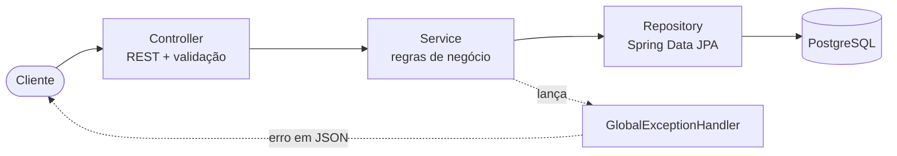
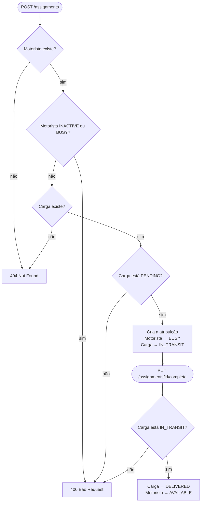
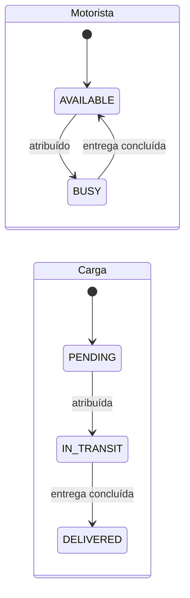

# Texas Logistics API

[🇺🇸 English](README.md) | 🇧🇷 Português

API REST de logística construída com **Java 21** e **Spring Boot 4**. Gerencia **motoristas** (drivers), **cargas** (shipments) e as **atribuições** (assignments) que ligam os dois, aplicando regras de negócio reais, como disponibilidade do motorista e ciclo de vida da carga.

> Projeto criado como estudo prático de desenvolvimento backend com Java.

## Funcionalidades

- CRUD completo de motoristas e cargas
- Fluxo de atribuição: designar um motorista a uma carga e depois concluir a entrega
- Regras de negócio aplicadas na camada de serviço (veja [Regras de negócio](#regras-de-negócio))
- Paginação, ordenação e filtro opcional por status nas listagens
- Bean Validation em todos os corpos de requisição
- Tratamento de erros centralizado, com formato JSON padronizado
- Documentação interativa da API com Swagger UI (OpenAPI)
- Testes unitários com JUnit 5, Mockito e AssertJ

## Tecnologias

| Área | Tecnologia |
|---|---|
| Linguagem | Java 21 |
| Framework | Spring Boot 4.0.6 (Web MVC, Data JPA, Validation) |
| Banco de dados | PostgreSQL |
| Build | Maven (Maven Wrapper incluso) |
| Documentação | springdoc OpenAPI / Swagger UI |
| Testes | JUnit 5, Mockito, AssertJ |

## Arquitetura

Toda requisição segue o mesmo fluxo em camadas. As entidades nunca saem da API: entrada e saída usam DTOs.



Estrutura do projeto (pacote raiz `com.jose.texaslogistics`):

```
driver/      Entidade Driver, controller, service, repository, DTOs, exceções
shipment/    Entidade Shipment, controller, service, repository, DTOs, exceções
assignment/  Entidade Assignment, controller, service, repository, DTOs, exceções
exception/   GlobalExceptionHandler (um único handler para todos os módulos)
config/      Configuração do OpenAPI
```

## Regras de negócio

O coração do projeto é o ciclo de vida de motoristas e cargas, controlado pelas atribuições:



Resumo dos estados:



Outras regras:

- Um motorista que possui atribuições **não pode ser excluído** (retorna `409 Conflict`).
- `createAssignment` roda dentro de uma transação, então as mudanças de status do motorista e da carga acontecem juntas ou não acontecem.

## Endpoints

| Método | Caminho | Descrição |
|---|---|---|
| `POST` | `/drivers` | Cria um motorista |
| `GET` | `/drivers` | Lista motoristas (paginado, filtro opcional `status`) |
| `GET` | `/drivers/{id}` | Busca um motorista por ID |
| `PUT` | `/drivers/{id}` | Atualiza um motorista |
| `DELETE` | `/drivers/{id}` | Exclui um motorista (bloqueado se tiver atribuições) |
| `POST` | `/shipments` | Cria uma carga |
| `GET` | `/shipments` | Lista cargas (paginado, filtro opcional `status`) |
| `GET` | `/shipments/{id}` | Busca uma carga por ID |
| `PUT` | `/shipments/{id}` | Atualiza uma carga |
| `DELETE` | `/shipments/{id}` | Exclui uma carga |
| `POST` | `/assignments` | Atribui um motorista a uma carga |
| `GET` | `/assignments` | Lista atribuições (paginado) |
| `GET` | `/assignments/{id}` | Busca uma atribuição por ID |
| `GET` | `/assignments/driver/{driverId}` | Lista as atribuições de um motorista |
| `PUT` | `/assignments/{id}/complete` | Conclui uma entrega |

Parâmetros de paginação nas listagens: `page`, `size`, `sort` (por exemplo `/drivers?status=AVAILABLE&page=0&size=10&sort=name,asc`).

### Respostas de erro

| Status | Quando |
|---|---|
| `400 Bad Request` | Validação falhou, ou uma regra de negócio foi violada (motorista inativo/ocupado, carga não atribuível, carga fora de trânsito) |
| `404 Not Found` | Motorista, carga ou atribuição não existe |
| `409 Conflict` | Exclusão de motorista que possui atribuições |

Exemplo:

```json
{
  "timestamp": "2026-10-28T23:44:45.806397Z",
  "status": 409,
  "error": "Conflict",
  "message": "Driver with id 8 cannot be deleted because it has assignments."
}
```

## Como rodar

### Pré-requisitos

- Java 21
- PostgreSQL rodando localmente

### 1. Crie o banco de dados

A configuração padrão espera o PostgreSQL na porta `5433` e um banco chamado `texas_logistics_db`:

```sql
CREATE DATABASE texas_logistics_db;
```

### 2. Configure as credenciais

Edite `src/main/resources/application.properties` e ajuste a URL, o usuário e a senha do banco para a sua máquina. Não envie senhas reais para um repositório público.

### 3. Execute a aplicação

```bash
./mvnw spring-boot:run
```

A API sobe em `http://localhost:8080`.

### 4. Explore a API

Abra o Swagger UI: <http://localhost:8080/swagger-ui/index.html>

## Rodando os testes

```bash
./mvnw clean test
```

A suíte tem hoje **23 testes unitários** cobrindo os services de driver, assignment e shipment (caminhos de sucesso e cada falha de regra de negócio), usando JUnit 5 e Mockito no padrão Arrange-Act-Assert.

## Roadmap

- [x] Documentação Swagger de drivers, shipments e assignments
- [x] Respostas de erro padronizadas (`ErrorResponse`)
- [x] Testes unitários do `ShipmentService`
- [ ] Testes de controller (MockMvc) e de integração (Testcontainers)
- [ ] Docker e docker-compose com PostgreSQL
- [ ] Lock otimista para evitar atribuições duplicadas com concorrência
- [ ] Spring Security com JWT e acesso por papéis (admin, dispatcher, driver)
- [ ] Histórico de status e auditoria

## Autor

**José Neto**: [GitHub](https://github.com/zeneto2978)
